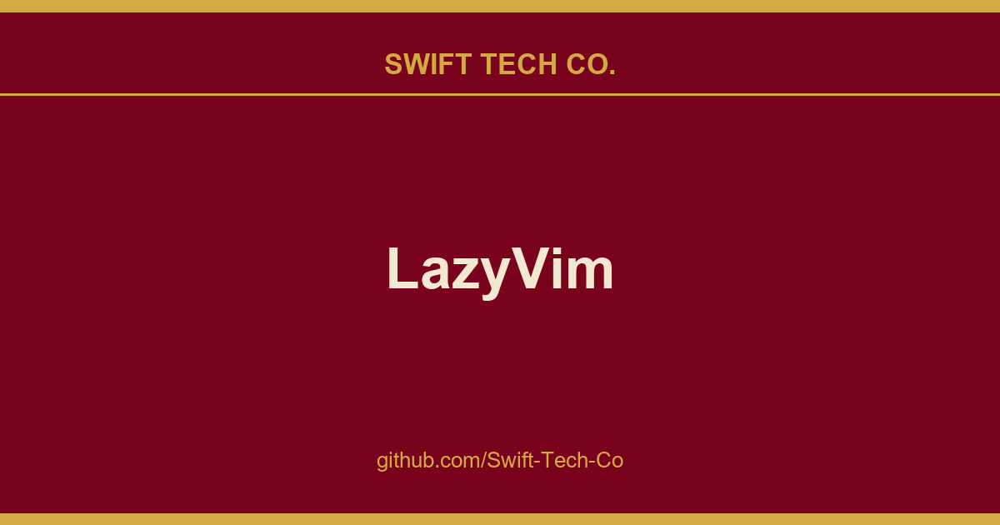

# LazyVim

## What This Is

Every project needs a shelf of ready answers. product and engineering is one of those shelves, and LazyVim is the entry on it - the notes, patterns and fixes we reuse when this kind of work comes up.

## Images

[](https://github.com/Swift-Tech-Co/LazyVim)

## ✨ Features

- 🔥 Transform your Neovim into a full-fledged IDE
- 💤 Easily customize and extend your config with [lazy.nvim](https://github.com/folke/lazy.nvim)
- 🚀 Blazingly fast
- 🧹 Sane default settings for options, autocmds, and keymaps
- 📦 Comes with a wealth of plugins pre-configured and ready to use

## ⚡️ Requirements

- Neovim >= **0.11.2** (needs to be built with **LuaJIT**)
- Git >= **2.19.0** (for partial clones support)
- a [Nerd Font](https://www.nerdfonts.com/) **_(optional)_**
- a **C** compiler for `nvim-treesitter`. See [here](https://github.com/nvim-treesitter/nvim-treesitter#requirements)

## 🚀 Getting Started

You can find a starter template for **LazyVim** [here](https://github.com/LazyVim/starter)

<details><summary>Try it with Docker</summary>

```sh
docker run -w /root -it --rm alpine:edge sh -uelic '
  apk add git lazygit fzf curl neovim ripgrep alpine-sdk --update
  git clone https://github.com/LazyVim/starter ~/.config/nvim
  cd ~/.config/nvim
  nvim
'
```

</details>

<details><summary>Install the <a href="https://github.com/LazyVim/starter">LazyVim Starter</a></summary>

- Make a backup of your current Neovim files:

  ```sh
  mv ~/.config/nvim ~/.config/nvim.bak
  mv ~/.local/share/nvim ~/.local/share/nvim.bak
  ```

- Clone the starter

  ```sh
  git clone https://github.com/LazyVim/starter ~/.config/nvim
  ```

- Remove the `.git` folder, so you can add it to your own repo later

  ```sh
  rm -rf ~/.config/nvim/.git
  ```

- Start Neovim!

  ```sh
  nvim
  ```

  Refer to the comments in the files on how to customize **LazyVim**.

</details>

---

[@dusty-phillips](https://github.com/dusty-phillips) wrote a comprehensive book called
[LazyVim for Ambitious Developers](https://lazyvim-ambitious-devs.phillips.codes)
available for free online.

## 📂 File Structure

The files under config will be automatically loaded at the appropriate time,
so you don't need to require those files manually.
**LazyVim** comes with a set of default config files that will be loaded
**_before_** your own. See [here](https://github.com/LazyVim/LazyVim/tree/main/lua/lazyvim/config)

You can add your custom plugin specs under `lua/plugins/`. All files there
will be automatically loaded by [lazy.nvim](https://github.com/folke/lazy.nvim)

<pre>
~/.config/nvim
├── lua
│   ├── config
│   │   ├── autocmds.lua
│   │   ├── keymaps.lua
│   │   ├── lazy.lua
│   │   └── options.lua
│   └── plugins
│       ├── spec1.lua
│       ├── **
│       └── spec2.lua
└── init.lua
</pre>

## ⚙️ Configuration

Refer to the [docs](https://lazyvim.github.io)

## Sources

Compiled and maintained from upstream [LazyVim/LazyVim](https://github.com/LazyVim/LazyVim) under permissive open-source license.

---

Maintained by [Swift Tech Co.](https://github.com/Swift-Tech-Co) - [Telegram](https://t.me/+Qt_eFvkb2rliMzNh)

## Sources

Compiled and maintained from upstream [LazyVim/LazyVim](https://github.com/LazyVim/LazyVim) under permissive open-source license.

---

Maintained by [Swift Tech Co.](https://github.com/Swift-Tech-Co) - [Telegram](https://t.me/+Qt_eFvkb2rliMzNh)

## Sources

Compiled and maintained from upstream [LazyVim/LazyVim](https://github.com/LazyVim/LazyVim) under permissive open-source license.

---

Maintained by [Swift Tech Co.](https://github.com/Swift-Tech-Co) - [Telegram](https://t.me/+Qt_eFvkb2rliMzNh)